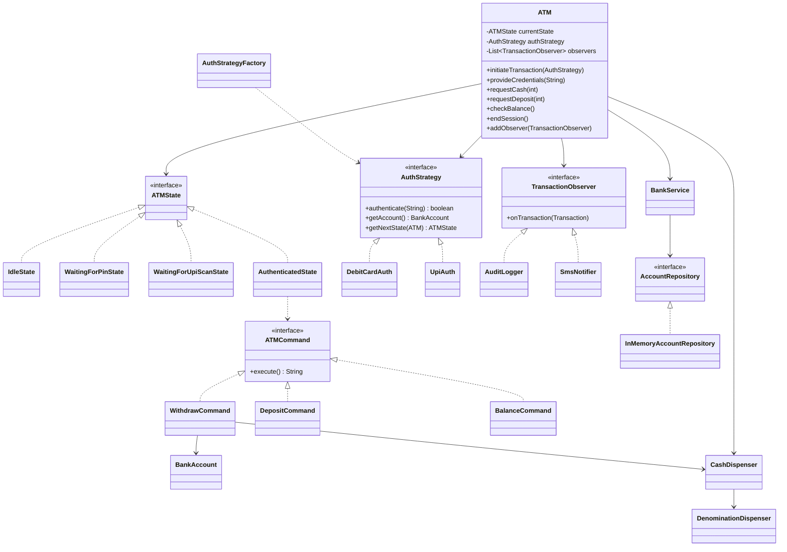
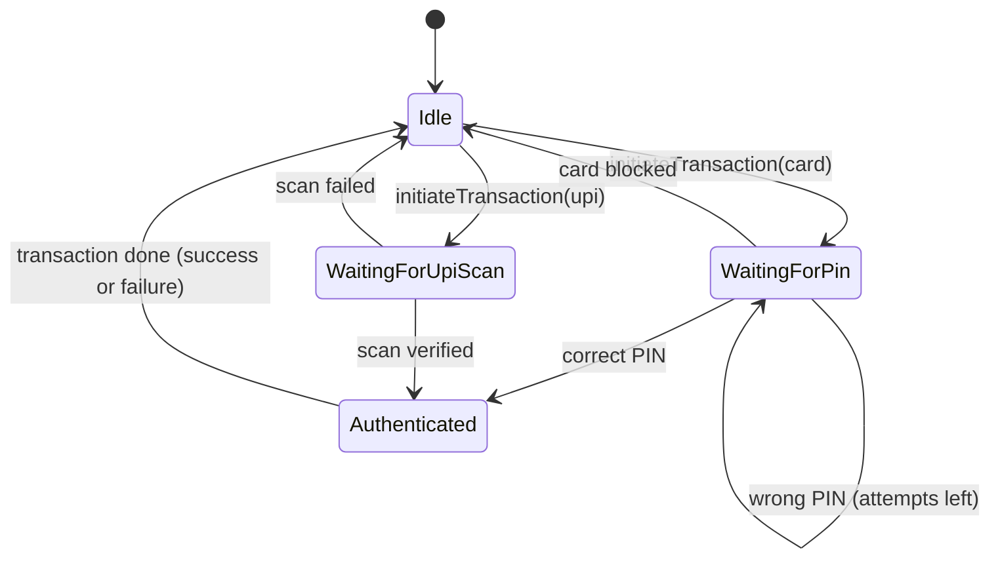
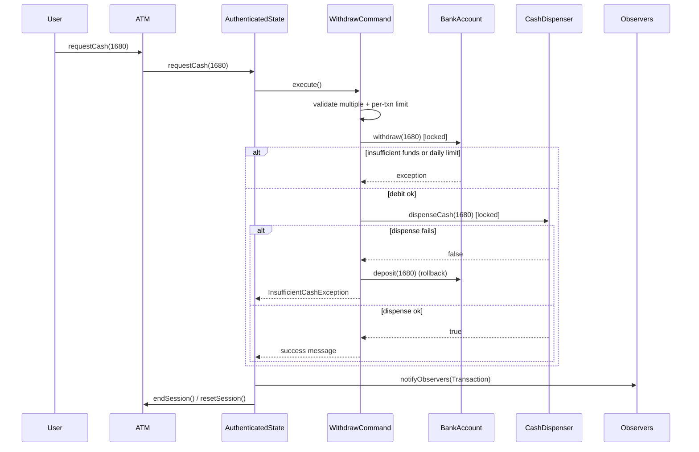

# ATM System: Low-Level Design (Java)

A production-style **Low-Level Design** of an ATM, built in plain Java. It supports **debit card + PIN** and **cardless UPI** withdrawals, deposits and balance checks, with thread-safe account handling, PIN lockout, rollback on hardware failure, and an audit trail.

The goal of this project is to show how **SOLID principles and seven design patterns** fit together in one small, runnable system, not just to list them.

---

## Table of Contents

- [Features](#features)
- [Architecture at a Glance](#architecture-at-a-glance)
- [Design Patterns Used](#design-patterns-used)
- [State Machine](#state-machine)
- [Withdrawal Flow](#withdrawal-flow)
- [Project Structure](#project-structure)
- [Concurrency Design](#concurrency-design)
- [Error Handling](#error-handling)
- [Configuration](#configuration)
- [Getting Started](#getting-started)
- [Demo Scenarios](#demo-scenarios)
- [Design Decisions and Trade-offs](#design-decisions-and-trade-offs)
- [Known Limitations](#known-limitations)
- [Future Improvements](#future-improvements)

---

## Features

| Area | What it does |
|---|---|
| **Authentication** | Debit card + PIN, or cardless UPI QR scan, behind one interface |
| **Transactions** | Withdraw cash, deposit cash, check balance |
| **Security** | PIN retry counter, card blocked after 3 wrong PINs, session cleared after every transaction |
| **Limits** | Per-transaction limit, daily withdrawal limit, notes must be a multiple of the smallest denomination |
| **Cash handling** | Multiple denominations (500, 100, 50, 20, 10) dispensed with a two-phase check-then-dispense |
| **Consistency** | Digital debit first, physical dispense second, automatic **rollback** if the hardware fails |
| **Concurrency** | Per-account lock, hardware lock, atomic PIN attempt counter |
| **Observability** | Every transaction (success or failure) is published to observers (audit log, SMS) |

---

## Architecture at a Glance



---

## Design Patterns Used

| Pattern | Where | Why it is used |
|---|---|---|
| **State** | `ATMState` and its four implementations | Each state allows only the actions valid in it. No giant `if/else` on a status flag. Invalid actions are rejected by the state itself. |
| **Strategy** | `AuthStrategy`, `DebitCardAuth`, `UpiAuth` | Authentication method is swappable at runtime. `ATM` never knows which one it is using. |
| **Factory** | `AuthStrategyFactory` | Callers get an `AuthStrategy` without depending on concrete classes. |
| **Command** | `WithdrawCommand`, `DepositCommand`, `BalanceCommand` | Each operation is an object with the same lifecycle (execute, record, notify). A new operation is a new class. |
| **Observer** | `TransactionObserver`, `AuditLogger`, `SmsNotifier` | Side effects (logging, SMS) are decoupled from the transaction logic. |
| **Chain of Responsibility** | `DenominationDispenser` | Each denomination handles what it can and passes the rest on. A new note value is a new link in the chain. |
| **Repository** | `AccountRepository`, `InMemoryAccountRepository` | Persistence is hidden behind an interface, so the in-memory store can be replaced by a database. |

### SOLID mapping

- **S**: `BankService` owns business rules, the repository owns storage, states own flow, commands own operations.
- **O**: new auth type, new transaction type, new observer or new note value are all added without editing existing classes.
- **L**: any `ATMState`, `AuthStrategy` or `ATMCommand` can replace another through its interface.
- **I**: small interfaces (`TransactionObserver` has one method). `ATMState` uses `default` methods so states only override what they support.
- **D**: `BankService` depends on `AccountRepository`, and `ATM` depends on interfaces, not concrete classes.

---

## State Machine



A session always ends in `Idle`. After any transaction the session is reset, so the next user never inherits the previous user's authentication.

---

## Withdrawal Flow



**Why debit before dispense?** If the order were reversed, a crash after dispensing but before debiting would give away free cash. Debiting first and rolling back on failure keeps the bank's books safe.

---

## Project Structure

```
src/main/java/com/ATM/atm
├── AtmApplication.java          # Runnable demo (6 scenarios)
├── core
│   └── ATM.java                 # Context: holds state, strategy, observers
├── state
│   ├── ATMState.java            # State interface (default methods for deposit/balance)
│   ├── IdleState.java
│   ├── WaitingForPinState.java
│   ├── WaitingForUpiScanState.java
│   └── AuthenticatedState.java  # Runs commands, publishes transactions
├── strategy
│   ├── AuthStrategy.java
│   ├── DebitCardAuth.java
│   └── UpiAuth.java
├── factory
│   └── AuthStrategyFactory.java
├── command
│   ├── ATMCommand.java
│   ├── WithdrawCommand.java
│   ├── DepositCommand.java
│   └── BalanceCommand.java
├── observer
│   ├── TransactionObserver.java
│   ├── AuditLogger.java
│   └── SmsNotifier.java
├── service
│   └── BankService.java         # PIN verification, lockout, account lookup
├── repository
│   ├── AccountRepository.java
│   └── InMemoryAccountRepository.java
├── entity
│   ├── BankAccount.java         # Thread-safe balance + daily limit
│   ├── Card.java
│   └── Transaction.java         # Immutable record of every attempt
├── hardware
│   ├── CashDispenser.java       # Two-phase dispense under a lock
│   └── DenominationDispenser.java
├── enums
│   ├── TransactionType.java
│   ├── TransactionStatus.java
│   └── AuthType.java
├── exception
│   ├── ATMException.java        # Base class
│   ├── InsufficientFundsException.java
│   ├── InsufficientCashException.java
│   ├── InvalidPinException.java
│   ├── CardBlockedException.java
│   ├── LimitExceededException.java
│   └── InvalidOperationException.java
└── config
    └── ATMConfig.java           # Limits and constants in one place
```

---

## Concurrency Design

The ATM is designed so that two sessions hitting the same account or the same cash dispenser cannot corrupt state.

| Shared resource | Protection | Problem it prevents |
|---|---|---|
| `BankAccount` balance and daily total | `ReentrantLock` around check **and** update | Check-then-act race: two threads both see enough balance and both withdraw |
| `CashDispenser` note counts | `hardwareLock` around `canDispense` **and** `executeDispense` | Two threads planning against the same note counts and over-dispensing |
| PIN attempt counter | `ConcurrentHashMap.merge(..., Integer::sum)` | Lost updates when two threads fail a PIN at the same time |
| Observer list | `CopyOnWriteArrayList` | Concurrent registration and notification |
| Audit history | `CopyOnWriteArrayList` | Concurrent appends from several ATM sessions |

**Demo proof:** Scenario 6 starts two threads that both withdraw Rs.3000 from an account holding Rs.3520. Exactly one succeeds; the other gets a clean `[FAILED] Insufficient account balance` message.

---

## Error Handling

All domain errors extend `ATMException` (a `RuntimeException`), so callers can catch one base type or a specific one.

| Exception | Raised when |
|---|---|
| `InsufficientFundsException` | Withdrawal is larger than the balance |
| `LimitExceededException` | Per-transaction or daily limit is crossed |
| `InsufficientCashException` | ATM cannot make the amount from the notes it holds (the debit is rolled back) |
| `CardBlockedException` | Wrong PIN entered `MAX_PIN_ATTEMPTS` times |
| `InvalidPinException` | Wrong PIN, carries the attempts left |
| `InvalidOperationException` | An action is not allowed in the current state |

Failures are never printed and forgotten. They become a `Transaction` with status `FAILED` and are sent to every observer.

---

## Configuration

All limits live in `ATMConfig`:

```java
public static final int  MAX_PIN_ATTEMPTS        = 3;
public static final long PER_TXN_LIMIT           = 20_000;
public static final long DAILY_WITHDRAWAL_LIMIT  = 40_000;
public static final int  NOTE_MULTIPLE           = 10;
```

Default demo data: account `ACC-1001` with Rs.5,000, card `CARD-123` (PIN `4321`), UPI ID `user@upi`. The dispenser is loaded with Rs.7,400 (500 x 10, 100 x 10, 50 x 10, 20 x 20, 10 x 50).

---

## Getting Started

### Prerequisites

- Java 17 or later (the factory uses a `switch` expression)
- Maven (or use the included `mvnw` wrapper)

### Build and run

```bash
git clone https://github.com/<your-username>/<your-repo>.git
cd <your-repo>

# Build
./mvnw clean compile        # Windows: mvnw.cmd clean compile

# Run the demo
./mvnw exec:java -Dexec.mainClass="com.ATM.atm.AtmApplication"
```

Or open the project in IntelliJ IDEA and run `AtmApplication`.

### Using the API in code

```java
BankService bank = new BankService();
ATM atm = new ATM(bank, new CashDispenser());
atm.addObserver(new AuditLogger());
atm.addObserver(new SmsNotifier());

// Debit card withdrawal
atm.initiateTransaction(AuthStrategyFactory.debitCard("CARD-123", bank));
atm.provideCredentials("4321");
atm.requestCash(1680);

// Cardless UPI balance check
atm.initiateTransaction(AuthStrategyFactory.upi(bank));
atm.provideCredentials("user@upi");
atm.checkBalance();
```

---

## Demo Scenarios

`AtmApplication` runs these scenarios in order:

| # | Scenario | What it demonstrates |
|---|---|---|
| 1 | Debit card withdrawal of Rs.1680 | Strategy + State + Command + Chain of Responsibility |
| 2 | UPI withdrawal of Rs.300 | Same account reached through a different auth strategy |
| 3 | Balance check and deposit | New commands without touching `ATM` |
| 4 | Invalid actions (cash before login, cash before PIN) | State pattern rejecting actions safely |
| 5 | Three wrong PINs | PIN retry counter and card block |
| 6 | Two threads withdrawing Rs.3000 at once | Lock-based race-condition prevention |

The run ends by printing the full audit history from `AuditLogger`.

---

## Design Decisions and Trade-offs

**Why exceptions instead of boolean returns?**
A `boolean` cannot say why an operation failed. Typed exceptions let the state show the right message and let the audit log record the exact reason.

**Why does `BankService` own PIN lockout, not the state?**
Lockout is a business rule. States only manage the flow. This keeps the rule reusable if another channel (mobile, branch) needs it.

**Why `long` for money?**
Floating point cannot represent values like 0.1 exactly. Amounts are whole rupees here, so `long` is exact. A real system would use `BigDecimal` or integer paise.

**Why `default` methods on `ATMState`?**
Deposit and balance are only valid once authenticated. Defaults reject them everywhere else, and only `AuthenticatedState` overrides them. Adding an operation does not force edits in every state.

**Why a two-phase dispense?**
`canDispense` builds a plan without touching note counts, and `executeDispense` commits it. The machine never ends up half-dispensed.

**Why one `ATM` per session in the concurrency demo?**
A physical ATM serves one user at a time. The demo models two machines (or an ATM and an online channel) sharing the same bank and dispenser, which is where the real contention is.

---

## Known Limitations

- **Greedy denomination chain.** With limited notes, greedy can reject an amount that is actually possible (for example Rs.60 with one Rs.50 and three Rs.20 notes but no Rs.10). An exact solution needs DP or backtracking.
- **Plain-text PINs.** Demo data stores PINs as strings. A real system stores a salted hash and verifies inside an HSM.
- **In-memory storage.** All state is lost on restart.
- **Daily limit reset.** `BankAccount.resetDailyLimit()` exists, but nothing schedules it yet.
- **No session timeout.** An abandoned session stays open until `endSession()` is called.

---

## Future Improvements

- [ ] Replace greedy dispensing with a DP-based exact change solver
- [ ] JPA/MySQL implementation of `AccountRepository`
- [ ] Hash PINs with BCrypt and add an HSM-style verifier interface
- [ ] Session timeout using a `ScheduledExecutorService`
- [ ] Scheduled daily-limit reset
- [ ] Receipt printing as another observer
- [ ] Mini-statement command (last N transactions from the audit log)
- [ ] Cash refill and low-cash alerts for the dispenser
- [ ] Unit tests (JUnit 5 + Mockito), including a concurrency test with `ExecutorService`
- [ ] REST layer on top of the core using Spring Boot

---

## License

This project is released under the MIT License. Add a `LICENSE` file before publishing.
